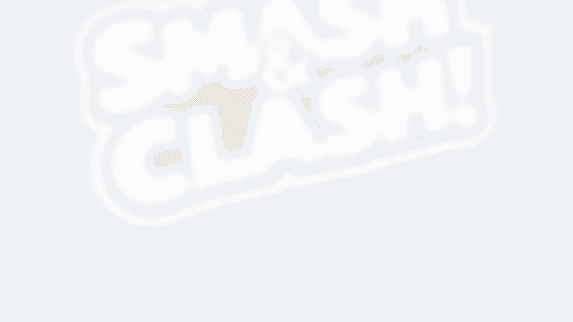
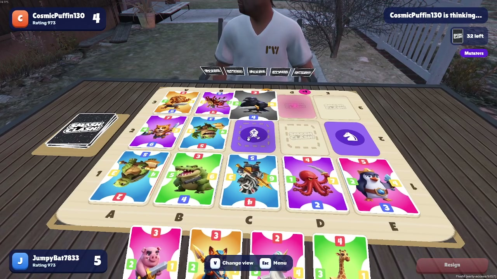

<p align="center">
  
</p>

<h1 align="center">Smash&Clash in GTA V</h1>

<p align="center">
  <a href="https://github.com/smashandclash/gtav/releases/latest">Download for your server</a> ·
  <a href="https://docs.smashandclash.in/clients">One game, every client</a> ·
  <a href="https://docs.smashandclash.in/sdk">SDK</a> ·
  <a href="https://www.smashandclash.in">smashandclash.in</a>
</p>

<p align="center">
  <b>Watch:</b>
  <a href="https://github.com/smashandclash/gtav/releases/download/v1.0.0/smashandclash-gtav-launch-16x9.mp4">the launch film (16:9)</a> ·
  <a href="https://github.com/smashandclash/gtav/releases/download/v1.0.0/smashandclash-gtav-launch-9x16.mp4">9:16</a>
</p>



Smash&Clash at tables in Los Santos. Sit down and the board lies on the table in front of you: the board from [smashandclash.in](https://www.smashandclash.in), its tiles, chess and power tiles, every card in its owner's colour, your cards standing at your edge. Cards drop onto the board, flip when they're captured, hop off chess tiles and crumble under a Boulder. Anyone walking past sees the game play out.

It's a [FiveM](https://fivem.net) resource, built on the [Smash&Clash SDK](https://docs.smashandclash.in). A player at a table in GTA plays on the same network as everyone else: the website, the apps, Telegram, Minecraft, the terminal, a Nintendo DS. Rooms, codes and quick match work across all of them.

## Playing

- **Sit down:** press E at a free chair, or **F7** (`/smash`) anywhere to put down a table of your own. F7 also brings your panel back while you're seated.
- **PLAY** starts a game now, against a player at your level. **Quick match** joins the queue every Smash&Clash app shares. **Play a friend** makes a room code anyone joins on any app, or joins theirs.
- **Play the person across the table:** when someone sits opposite, a button opens a game for them; they accept on their screen. When your opponent isn't at the table (they're on another app), a character sits across and plays their cards.
- **While you play,** the mouse moves your head. Look at a card and click to pick it up, then look at a glowing tile and click to place it. The wheel steps through your cards, right-click puts a card back, **V** changes the view (your eyes, close behind you, further back) and **Esc** opens the menu.
- Mutators and Classic, your rating, the Game Review after each game, the game's music, effects, announcer and character voices. A controller works too (D-pad, A, B, LB / RB).

## Add it to your server

It's a standalone resource: no framework (ESX, QBCore, vRP) and no database, so it sits alongside whatever your server runs. It streams no game assets, and it works on FiveM for GTA V Legacy and FiveM for GTAV Enhanced, with or without OneSync.

1. Download `smashandclash.zip` from the [latest release](https://github.com/smashandclash/gtav/releases/latest) and unzip it into your server's `resources` folder (you get `resources/smashandclash`).
2. Add `ensure smashandclash` to `server.cfg`.
3. Restart the server. Two tables are on the map (Legion Square and Del Perro Pier), and every player can press F7 for one of their own.

### Settings

Everything is in [`shared/config.lua`](resource/smashandclash/shared/config.lua):

| Setting | Default | Does |
| --- | --- | --- |
| `Config.Tables` | Legion Square, Del Perro Pier | Tables that are always there. Remove them or add your own |
| `Config.OwnTables` | `true` | Players can put down a table of their own with F7 / `/smash` |
| `Config.OwnTableAce` | `false` | Only players with the `smashandclash.own` ace can (`add_ace group.vip smashandclash.own allow`) |
| `Config.MaxOwnTables` | `24` | How many tables of their own can be out at once |
| `Config.TempTableSeconds` | `90` | How long an empty table of one's own stays |
| `Config.RequestsPerPlayer` / `Config.RequestsPerServer` | `90` / `1500` | Calls to smashandclash.in per minute, for each player and for the whole server |
| `Config.Command` / `Config.Key` | `smash` / `F7` | The command and its default key (players can rebind it in GTA's settings, Key Bindings > FiveM) |
| `Config.TableModels` / `Config.ChairModels` | GTA's own props | The first model the game has is used |
| `Config.Blips` | `true` | Tables on the map |
| `Config.CheckForUpdates` | `true` | A note in the server console when a newer version is out |

### Permanent tables

Give your staff the command: `add_ace group.admin command.smashtable allow`. Then `/smashtable [name]` puts a table where they stand (saved across restarts) and `/smashtable_remove` takes the nearest one away.

### What it connects to

Players' games run on www.smashandclash.in, through your server: each player's page hands its calls to the server, which makes them (only `https://www.smashandclash.in/api/v1/`, within the limits above) and hands back the answer. Your players need nothing else, and nothing else goes out. Each player's seat in a game stays in their own client; the server only keeps who sits where and which game each table shows, so everyone around sees the same board.

### Updating

Download the new release and replace `resources/smashandclash`, keeping your `shared/config.lua`. The console says when a newer version is out.

## Try it on your own PC

1. Install **FiveM** (or **FiveM for GTAV Enhanced**) from [fivem.net](https://fivem.net).
2. Get a free server key at [portal.cfx.re](https://portal.cfx.re) and download the Cfx Server for Windows.
3. Add the resource as above, put your key (`sv_licenseKey`) in `server.cfg`, and start the server.
4. In FiveM, connect to `localhost`. Walk to the blip at Legion Square, or press F7 anywhere.

## Develop

```bash
npm install
```

```bash
npm run dev
```

The dev page (http://localhost:5394) runs the client in a browser and previews the table: the resource's own `client/board.lua` runs in a Lua 5.4 VM and draws on a canvas, so you can check the board and animations without starting GTA. `?name=` gives each tab its own player.

```bash
npm run check
```

Type-checks, runs the tests (the server scripts run in Lua with FiveM's functions stubbed) and compiles every Lua file. `npm run build` writes the page into `resource/smashandclash/html`, and `npm run release` builds `smashandclash.zip`.

The resource ships everything it shows and plays: card faces, strike drawings, music, effects, the announcer and one take of each character line (about 26 MB, downloaded once by each player). `npm run assets` copies them from the game's asset folder (`SNC_ASSETS`) into `nui/public`, with the deck and the sound list from the SDK.

| Part | Does |
| --- | --- |
| `nui/` (the page) | Runs the game through `@smashandclash/sdk`, shows the panel and HUD, follows nearby tables' games as a spectator, and tells the resource what each board shows and how each move plays out |
| `client/board.lua` | Draws a board: tiles, cards and every animation, as textured polygons in the world. Picks what you look or point at |
| `client/render.lua` | GTA's side of drawing: the atlas (one page with every card face and sprite) and the strike drawings |
| `client/tables.lua` | Tables, chairs, sitting down, the camera at your eyes, the character across |
| `server/main.lua` | Who sits where, which game each table shows, and the room code from one chair to the other |
| `server/http.lua` | Makes each player's calls to smashandclash.in, within the server's limits |

## Licence

The code is MIT. The characters, art, audio and the Smash&Clash name stay Smash&Clash's: they're free to use in clients built for Smash&Clash, never to present as your own ([terms](https://www.smashandclash.in/terms#developers)).

GTA V and FiveM belong to Rockstar Games and Cfx.re. This resource follows Rockstar's mod guidelines: it's free and non-commercial. Not affiliated with or endorsed by Rockstar Games or Cfx.re.
